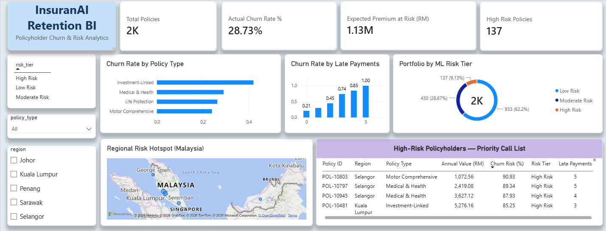
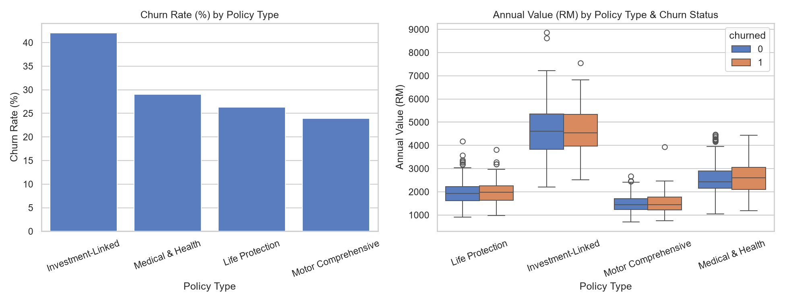
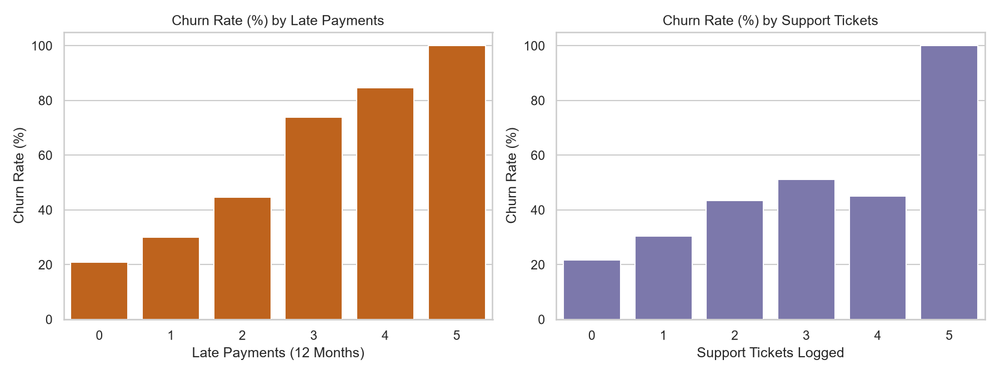
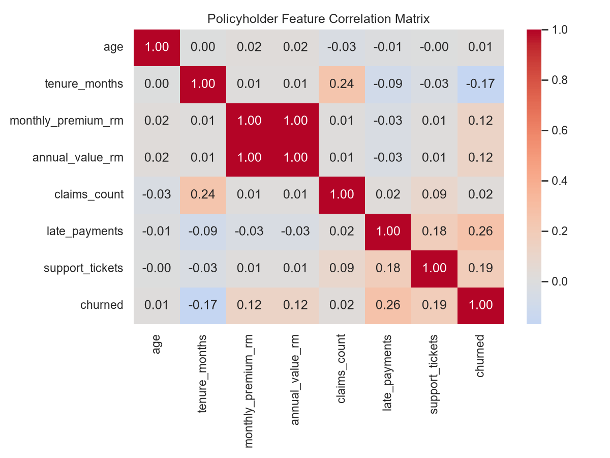
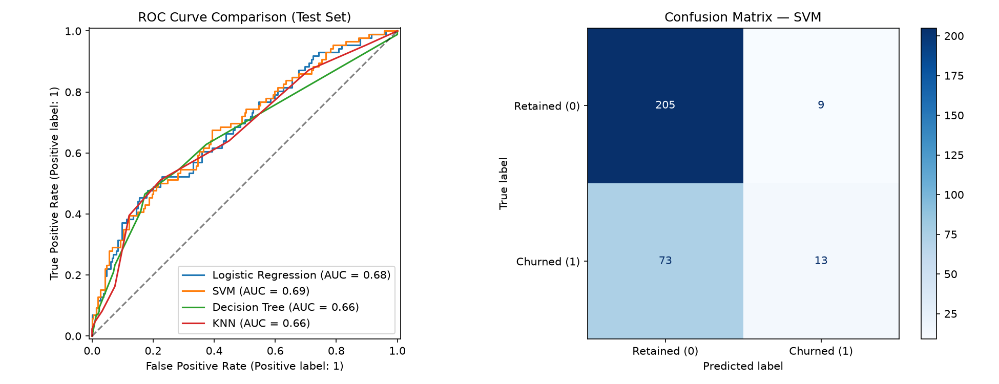

# 🛡️ InsurAI: Policyholder Retention & Risk Analytics Pipeline

> An end-to-end data engineering, predictive machine learning, and Business Intelligence solution to predict insurance policyholder churn and protect annual recurring premium (RM).


---

## 📌 Executive Summary

Acquiring a new insurance policyholder costs significantly more than retaining an existing one. **InsurAI** answers three core business questions for insurance retention teams:

1. **How much annual recurring premium (RM) is currently at risk?**
2. **Which behavioral, product, and regional factors drive cancellations?**
3. **Which active policyholders are most likely to churn next, and who should agents call first?**

Built following the **IBM Data Science Methodology (CRISP-DM)**, the pipeline ingests messy raw records, normalizes them into a relational SQLite database, uncovers churn drivers via SQL and geospatial EDA, benchmarks four supervised classification models inside leakage-free Scikit-Learn pipelines, and delivers actionable risk scores into an interactive **Power BI** executive dashboard (plus a **Streamlit** risk simulator).

> **Note on Data:** `dataset/raw_policyholders.csv` (1,500 records) is synthetically generated from domain assumptions to simulate realistic data quality anomalies (inconsistent whitespace/casing and missing values) and regional/behavioral churn patterns for end-to-end pipeline development.

---

## 🎯 Business Objectives

| Objective | Description |
| :--- | :--- |
| **Automate ETL & Storage** | Clean messy raw policyholder records and enforce relational schema integrity in SQLite (`data/insurai.db`) |
| **Identify Attrition Drivers** | Quantify demographic, regional, product-tier, and billing-friction churn drivers using SQL & visual EDA |
| **Leakage-Free Predictive Modeling** | Benchmark 4 classifiers via 5-fold `GridSearchCV` using ROC-AUC & F1-score inside a `Pipeline` |
| **Prescriptive Actionability** | Batch-score policyholders into `Low`, `Moderate`, and `High Risk` tiers for prioritized retention outreach in Power BI |

---

## 🏗️ System Architecture

The project is structured as a modular, reproducible pipeline rather than a single monolithic script:

```text
dataset/raw_policyholders.csv (1,500 messy records)
        │
        ▼
┌─────────────────────┐     ┌──────────────────────────┐     ┌─────────────────────────┐
│ src/etl_pipeline.py │───▶ │   data/insurai.db        │───▶ │  src/train_model.py     │
│ (Clean, Impute &    │     │   (SQLite Relational DB) │     │  (4-Model GridSearchCV  │
│  Engineer Features) │     │                          │     │   & Leakage-Free Pipe)  │
└─────────────────────┘     └────────────┬─────────────┘     └────────────┬────────────┘
                                         │                                │
                                         │                                ▼
                                         │                   models/best_churn_model.pkl
                                         │                                │
                                         ▼                                ▼
                                ┌──────────────────────────────────────────────────┐
                                │              src/export_for_bi.py                │
                                │     (Batch Scoring + Risk Tier Assignment)       │
                                └────────────────────────┬─────────────────────────┘
                                                         │
                                                         ▼
                                           data/policyholders_scored.csv
                                                         │
                                           ┌─────────────┴─────────────┐
                                           ▼                           ▼
                              ┌─────────────────────────┐ ┌─────────────────────────┐
                              │   Power BI Dashboard    │ │  Streamlit App (app.py) │
                              │ (Executive BI & Action) │ │ (Live What-If Simulator)│
                              └─────────────────────────┘ └─────────────────────────┘
```

### Module Breakdown

- **`src/etl_pipeline.py`** — Extracts `dataset/raw_policyholders.csv`, trims and title-cases `region`, imputes missing `late_payments` with `0`, handles blank `churn_reason` values, engineers `annual_value_rm = monthly_premium_rm * 12`, and loads 1,500 zero-`NULL` records into `data/insurai.db`.
- **`src/train_model.py`** — Drops `policy_id` and `churn_reason` (preventing post-churn target leakage), splits data (`80/20` stratified), wraps `StandardScaler` + `OneHotEncoder(handle_unknown="ignore")` in a `ColumnTransformer` + `Pipeline`, benchmarks 4 classifiers via 5-fold `GridSearchCV`, and serializes the winner to `models/best_churn_model.pkl`.
- **`src/export_for_bi.py`** — Batch-scores all 1,500 policyholders with `predicted_churn_prob`, `risk_tier` (`Low Risk` < 30%, `Moderate Risk` 30–49.9%, `High Risk` >= 50%), and `expected_premium_at_risk_rm`, exporting `data/policyholders_scored.csv` for Power BI / Tableau.
- **`app.py`** — Interactive Streamlit BI dashboard & live "what-if" churn risk simulator with tailored retention recommendations.

---

## 📊 Key Business Insights

Across **1,500 policyholders**, **431 churned** (**28.73%** overall churn rate), exposing **RM 1,140,925.80** in annual recurring premium at risk.

### 🌍 Geographic Risk Hotspots
- **Kuala Lumpur** (`33.87%` churn, **RM 404,792.88** at risk) and **Johor** (`32.64%` churn, **RM 224,255.40** at risk) lead portfolio attrition, followed by **Selangor** (`27.33%`), **Penang** (`22.28%`), and **Sarawak** (`21.67%`).

### 📦 Product Tier Exposure
- **Investment-Linked** policies exhibit both the highest churn rate (**42.01%**) and the largest annual premium exposure (**RM 429,872.28**), ahead of **Medical & Health** (`29.00%`), **Life Protection** (`26.32%`), and **Motor Comprehensive** (`23.92%`).

### ⏳ Early-Tenure Vulnerability
- Policyholders in their **first 12 months** (`tenure_months < 12`) churn at **61.32%**, nearly **2.6x** the rate of established customers with `12+` months tenure (**23.37%**).

### 💳 Billing Friction & Service Complaints
- Customers with **2+ late payments** churn at **54.11%**, compared to **30.04%** for 1 late payment and **20.87%** for 0 late payments.
- The top stated reasons for cancellation are **Premium too expensive** (`142`), **Poor customer service** (`92`), and **Competitor offered better price** (`59`).

---

## 📈 Power BI Executive Dashboard



> The interactive Power BI dashboard (`InsurAI_Retention_Detection.pbix`) surfaces **Descriptive**, **Diagnostic**, **Predictive**, and **Prescriptive** analytics in one view: executive KPI cards, regional Malaysia hotspot mapping, policy & late-payment churn breakdowns, ML Risk Tier distribution (`933` Low, `430` Moderate, `137` High Risk), and a prioritized **High-Risk Call List** sorted by annual premium value.

---

## 🔍 Exploratory Data Analysis & Model Benchmarking

### Churn Rate & Value by Policy Type


### Behavioral Drivers: Late Payments & Support Tickets


### Feature Correlation Matrix


### 🤖 ML Classification Benchmark (5-Fold CV & 20% Held-Out Test Set)

| Model | CV ROC-AUC | Test Accuracy | Test F1 | Test ROC-AUC |
| :--- | :---: | :---: | :---: | :---: |
| **SVM** *(Selected)* | 0.7111 | 0.7267 | 0.2407 | **0.6852** |
| **Logistic Regression** | 0.7143 | 0.7367 | 0.3780 | 0.6810 |
| **KNN** | 0.6431 | 0.7067 | 0.2414 | 0.6645 |
| **Decision Tree** | 0.6709 | 0.7233 | 0.3025 | 0.6572 |



---

## 📁 Repository Structure

```text
InsurAI-PolicyHolder-Retention-Analytics/
├── assets/                                      # Saved EDA charts, Folium map & dashboard screenshots
├── data/
│   ├── insurai.db                               # Normalized SQLite database (policyholders & scored tables)
│   └── policyholders_scored.csv                 # ML-scored dataset for Power BI / Tableau
├── dataset/
│   ├── generate_raw_data.py                     # Synthetic raw data generator
│   └── raw_policyholders.csv                    # Raw 1,500-row policyholder dataset
├── models/
│   └── best_churn_model.pkl                     # Serialized winning Scikit-Learn pipeline (SVM)
├── notebooks/
│   ├── 01_Data_Collection_and_Wrangling.ipynb   # ETL, imputation & feature engineering
│   ├── 02_SQL_Exploratory_Data_Analysis.ipynb   # Analytical SQL queries & business takeaways
│   ├── 03_Geospatial_and_Visual_Analytics.ipynb # Seaborn charts & Folium Malaysia risk map
│   └── 04_ML_Classification_Benchmark.ipynb     # 4-model GridSearchCV & ROC-AUC evaluation
├── src/
│   ├── etl_pipeline.py                          # Production ETL script
│   ├── train_model.py                           # Production ML training & benchmarking script
│   └── export_for_bi.py                         # Batch-scoring export for Power BI / Tableau
├── app.py                                       # Interactive Streamlit dashboard & simulator
├── InsurAI_Retention_Detection.pbix             # Power BI Desktop executive dashboard
├── requirements.txt                             # Python environment dependencies
└── README.md
```

---

## 🛠️ Technology Stack

| Layer | Tools & Libraries |
| :--- | :--- |
| **Language & Environment** | Python 3.13, Jupyter Notebooks, Git & GitHub |
| **Data Wrangling & ETL** | `Pandas`, `NumPy` |
| **Database & Querying** | `SQLite3`, SQL (`GROUP BY`, `CASE WHEN`, subqueries) |
| **Visualization & Geospatial** | `Matplotlib`, `Seaborn`, `Folium` |
| **Machine Learning** | `Scikit-Learn` (`Pipeline`, `ColumnTransformer`, `GridSearchCV`), `Joblib` |
| **Business Intelligence & Apps** | **Power BI Desktop** (DAX, Power Query), **Streamlit** |

---

## 🚀 Getting Started

### 1. Clone the Repository
```bash
git clone https://github.com/danishhzim/InsurAI-PolicyHolder-Retention-Analytics.git
cd InsurAI-PolicyHolder-Retention-Analytics
```

### 2. Create a Virtual Environment & Install Dependencies
```powershell
python -m venv .venv
.\.venv\Scripts\python.exe -m pip install -r requirements.txt
```

### 3. Run the End-to-End Pipeline
```powershell
# 1. Clean raw data and load into SQLite (data/insurai.db)
.\.venv\Scripts\python.exe src\etl_pipeline.py

# 2. Train & benchmark 4 models, saving models/best_churn_model.pkl
.\.venv\Scripts\python.exe src\train_model.py

# 3. Batch-score policyholders for Power BI / Tableau (data/policyholders_scored.csv)
.\.venv\Scripts\python.exe src\export_for_bi.py
```

### 4. View the Dashboards
- **Power BI:** Open `InsurAI_Retention_Detection.pbix` in Power BI Desktop.
- **Streamlit Web App:**
  ```powershell
  .\.venv\Scripts\streamlit.exe run app.py
  ```
